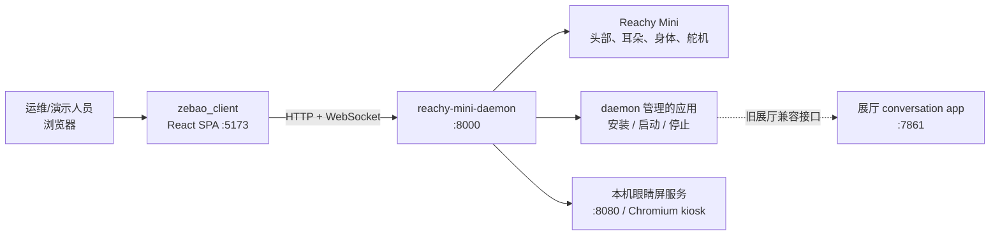
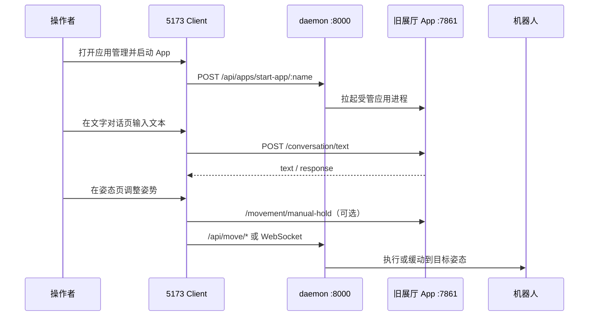
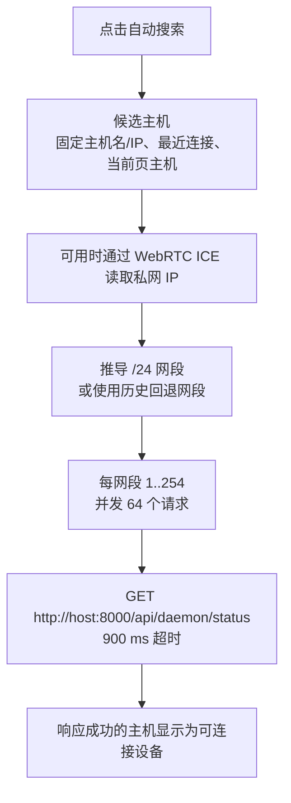
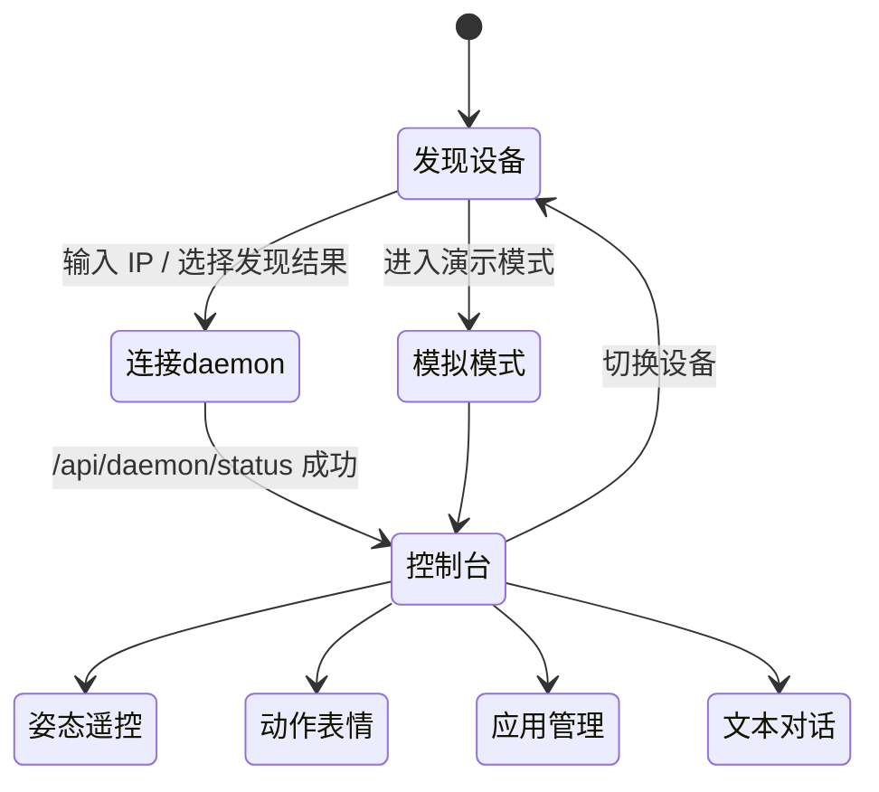
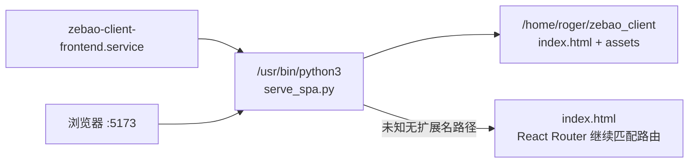

# Zebao Client（5173 机器人管理前端）

> 面向局域网 Reachy Mini / Zebao 的浏览器控制台：发现设备、连接 daemon、观察状态、管理应用、播放动作、调整姿态，并保留一条面向旧展厅 conversation app 的文本对话验证入口。

### 当前产品入口（2026-09-12）

- 连接后直接进入概览，不再提供独立配置向导。旧 `/dashboard/setup` 重定向至场景页。

- 场景工作区 `/dashboard/scenes`：从 App 的 `SceneRuntimeSnapshot` 展示真实挂载；切换后回读，未就绪时不制造默认场景。所有能力、知识源和展示目标均来自服务器。
- 概览中的场景运行卡同时读取 `/api/v1/ecosystem/skills`，展示当前代次的 Skill 合同、设备回读要求和授权标记；Client 只读发现，不直接执行 Skill。
- 基础系统 `/dashboard/foundation`：搜索并直接进入语音、呼吸、转向、身份、视觉、网络和工程设置。具身配置 `/dashboard/foundation/interaction` 使用同一 App API。
- 场景页内直接新建、复制、编辑、删除，能力勾选、语音/交互与知识/展示挂载仍使用 App 原 API 保存并发布；不另建配置库。模板、归档、流程和能力高级参数保留原管理入口，`↗` 表示打开原管理页。基础设置改为紧凑列表，工程工具默认折叠。
- `/dashboard/control?tab=interaction` 自动跳转至基础系统；动作、姿态、应用与仿真地址继续兼容。新版导航为概览、场景、基础系统、控制、应用。

场景原位编辑通过所选机器人 `5173/operator-api` 转发至本机 `127.0.0.1:7862`。仅允许指定场景接口与方法，禁止任意目标地址、公共网页来源和重定向；不会开放新的通用设备写接口。每台机器人需部署配套 `serve_spa.py`，不能只替换静态资源。

## 一眼看懂

| 项目 | 当前实现 |
| --- | --- |
| 前端地址 | `http://<树莓派 IP>:5173` |
| 真实部署服务 | 树莓派 `zebao-client-frontend.service`，以 `python3 serve_spa.py` 提供静态 SPA |
| 主要后端 | `reachy-mini-daemon` HTTP / WebSocket，默认 `:8000` |
| 前端框架 | React 18、TypeScript、React Router 7、Vite 6、Tailwind CSS 4 |
| 主要使用者 | 现场运维、演示人员、开发调试人员；不是面向最终访客的对话界面 |
| 控制对象 | daemon 生命周期、舵机模式、头/耳/身体姿态、预录动作、daemon 管理的应用 |
| 本地保存 | 浏览器 `localStorage`：当前设备、最近 10 个设备、模拟模式及姿态重同步标记 |
| 发布目标 | 0 号机 `192.168.3.83:5173`；静态构件由本仓库独立构建和发布 |

> **安全提醒：** 本客户端含有启动/停止/重启 daemon、切换舵机模式、执行运动、保存基准姿态、安装/卸载/启动应用等写操作。它不是只读看板；真机上执行前应确认机器人周围无人、线缆无拉扯、操作者了解当前姿态和应用状态。

## 界面结构

桌面端使用固定侧栏，移动端使用底部导航；概览、动作、姿态、应用、对话和物理仿真共用一套中文术语、状态组件与暖灰琥珀视觉。空状态、`等待服务` 或 `--` 表示浏览器尚未建立实际控制连接，不等同于设备服务停止。

## 它在整个系统中的位置

`zebao_client` 是管理面，不承担语音识别、模型推理、TTS 或眼睛屏渲染。它把操作者的浏览器动作转换为 daemon API 调用；daemon 再负责 Reachy Mini 的真实硬件控制与应用生命周期。



### 与语音系统的关系

语音链路属于办公室/展厅 conversation app，而不是本前端。该前端能做的是：从“应用管理”启动 daemon 管理的应用、在“文字对话”页用兼容接口发送一条文本、在姿态页对应用申请人工动作接管。



## 功能地图

| 页面 | 路由 | 做什么 | 主要后端 | 风险等级 |
| --- | --- | --- | --- | --- |
| 设备发现 | `/` | 输入 IP、扫描候选设备、连接最近设备、进入本地模拟模式 | `GET /api/daemon/status` | 低（扫描会产生网络请求） |
| 控制台 | `/dashboard` | 读取 daemon、状态流、舵机模式和当前 App；启动/停止/重启控制 | `/api/daemon/*`、`/api/state/full`、`/api/apps/current-app-status` | 高（控制生命周期） |
| 动作表情 | `/dashboard/motions` | 列出 dances/emotions 数据集并播放记录动作 | `/api/move/recorded-move-datasets/*` | 高（会运动） |
| 姿态遥控 | `/dashboard/pose` | 查看实时姿态、滑杆编辑、唤醒/休眠、保存基础姿态 | `/api/state/*`、`/api/move/*`、`/movement/manual-*` | 高（会运动/会写配置） |
| 应用管理 | `/dashboard/apps` | 读取、安装、启动、停止、卸载 daemon 托管的应用 | `/api/apps/*` | 高（会变更软件运行态） |
| 文字对话 | `/dashboard/chat` | 验证旧展厅 conversation app 的文本请求/回复 | `:7861/conversation/*` | 中（依赖旧兼容接口） |
| MuJoCo 物理仿真 | `/dashboard/simulation` | 启停本机官方 MuJoCo backend、单向镜像实体实测姿态、观察 App 动作安全包络 | 本机 `:8002` + 实体 `:8000` + 办公室 App 状态 | 低（镜像不写回实体） |

### 设备发现不是 mDNS 服务浏览器

浏览器安全模型不能直接枚举 `_reachy-mini._tcp.local`。实现采用“候选地址 + 并发 HTTP 探测”，而非真正的 mDNS 服务发现：



内置候选包含 `192.168.10.74`、`reachy-mini.local`、`reachy_mini.local`、`zebao.local` 等，亦会扫描若干历史私网段。现场网络较大、跨 VLAN、浏览器阻止混合内容或隐藏本机 ICE 地址时，**应优先手动输入树莓派 IP**，不要把自动搜索当作网络资产发现工具。

## 控制与数据链路

### 1. 连接、状态与仪表盘

连接成功后，前端把 daemon 基地址设为 `http://<host>:8000`，并保存当前设备。控制台每 4 秒刷新 daemon、完整状态和当前应用；姿态页另有更密集的实时读取/目标控制通道。

| 类型 | 接口 | 用途 |
| --- | --- | --- |
| daemon 状态 | `GET /api/daemon/status` | 判断 daemon 是否运行、后端是否就绪、读取错误和电机模式 |
| daemon 控制 | `POST /api/daemon/start?wake_up=` | 启动控制；控制台随后最多等待 20 秒确认就绪 |
|  | `POST /api/daemon/stop?goto_sleep=` | 停止控制；控制台随后最多等待 30 秒确认停止 |
|  | `POST /api/daemon/restart` | 重启控制；控制台随后最多等待 25 秒确认恢复 |
| 电机模式 | `GET /api/motors/status`、`POST /api/motors/set_mode/:mode` | 读取或设为 `enabled`、`disabled`、`gravity_compensation` |
| 完整状态 | `GET /api/state/full?...` | 状态流可达性、头部/身体姿态、控制模式 |
| 状态 WebSocket | `WS /api/state/ws/full?...` | 可供组件订阅实时状态的封装 |

### 2. 姿态与运动

姿态页提供“唤醒基准”和“睡眠基准”两个编辑基准；偏移覆盖 X/Z/Yaw/Pitch/Roll、身体 yaw 和左右耳。步进模式只在松手后按实际位移计算安全时长并使用 `minjerk` 缓动；实时模式通过 WebSocket 连续下发经过限步的目标，点击滑轨造成的大跨度变化不会直接打到舵机。动作页固定读取两个上游数据集：

- `pollen-robotics/reachy-mini-dances-library`
- `pollen-robotics/reachy-mini-emotions-library`

| 接口 | 写入内容 | 说明 |
| --- | --- | --- |
| `POST /api/move/goto` | 头部、耳朵、身体、持续时间、`minjerk` 插值 | 一次性缓动到姿态 |
| `POST /api/move/set_target` | 目标头部/耳朵/身体 | 更新目标姿态 |
| `WS /api/move/ws/set_target` | 连续目标 | 实时调姿通道 |
| `GET/POST /api/move/basic-poses?use_pose_matrix=false` | init/sleep 基准 | 读取或持久化基础姿态 |
| `POST /api/move/play/wake_up` | 唤醒动作 | 会运动 |
| `POST /api/move/play/goto_sleep` | 休眠动作 | 会运动 |
| `POST /api/move/play/recorded-move-dataset/:dataset/:move` | 指定动作 | 会运动 |
| `POST /api/move/stop` | 动作 UUID | 停止可停止的运动 |

姿态页还会尝试向对话应用请求 `/movement/manual-hold` 和 `/movement/manual-release`，用于临时让对话应用让出动作控制权；若 `:7860` 与 `:7861` 都不可用，前端会继续工作，但不会获得应用层协作锁。

### 3. 应用管理

应用页分为“已安装”与“可安装”。已安装列表默认读取；只有点击获取目录时才请求可安装应用。安装、卸载等请求先获得 `job_id`，随后轮询作业状态显示日志或错误。

| 接口 | 行为 |
| --- | --- |
| `GET /api/apps/list-available` | 已安装/本地可见应用 |
| `GET /api/apps/list-available/:sourceKind` | 按来源列出候选应用 |
| `POST /api/apps/install` | 提交安装任务，返回 `job_id` |
| `POST /api/apps/remove/:name` | 提交卸载任务，返回 `job_id` |
| `POST /api/apps/start-app/:name` | 启动指定应用 |
| `POST /api/apps/stop-current-app` | 停止当前受管应用 |
| `GET /api/apps/current-app-status` | 当前应用状态 |
| `GET /api/apps/job-status/:jobId` | 安装/卸载任务状态、日志和错误 |

## 前端工程结构

```text
zebao_client/
├─ src/
│  ├─ App.tsx                         # 路由、连接恢复、模拟模式
│  ├─ api/                            # daemon / apps / motors / move / state 封装
│  ├─ hooks/useDiscovery.ts            # 浏览器侧候选网段扫描
│  ├─ hooks/useRobot.ts                # 连接验证、最近设备记录
│  ├─ features/
│  │  ├─ discovery/                    # 连接页
│  │  ├─ dashboard/                    # 状态与生命周期控制
│  │  ├─ pose-control/                 # 姿态遥控与基准姿态
│  │  ├─ motion-control/               # 舞蹈/表情动作
│  │  ├─ app-manager/                  # daemon 应用管理
│  │  ├─ conversation/                 # 旧展厅文本对话兼容入口
│  │  └─ simulation/                   # 官方 MuJoCo 物理仿真、实体单向镜像与状态缩略图
│  ├─ utils/storage.ts                 # localStorage 读写
│  └─ index.css                        # Tailwind 与毛玻璃视觉样式
├─ public/                             # 静态资源
├─ serve_spa.py                        # 树莓派生产静态服务 + SPA 路由回退
├─ vite.config.ts                      # Vite 开发服务器，默认 :5173
└─ package.json
```

### 路由与状态恢复



浏览器刷新时，`App.tsx` 会读取 `zebao_current_robot` 并尝试恢复连接；旧端口 `15347` 会归一化为当前默认 daemon 端口 `8000`。模拟模式只修改本地状态，不会向机器人发请求。

## 服务、端口与部署

| 服务 | 端口 | 责任 | 5173 Client 的关系 |
| --- | ---: | --- | --- |
| `zebao-client-frontend.service` | 5173 | 为本项目提供静态 SPA | 本项目自身 |
| `reachy-mini-daemon.service` | 8000 | 机器人 SDK、运动、状态、应用管理 | 主要依赖 |
| 眼睛屏服务 | 8080 | 树莓派本机眼睛 WebSocket/Chromium kiosk | 不由 client 直接管理 |
| 旧展厅 conversation app | 7861 | 旧 `/conversation/*` 文本接口、部分动作协作接口 | 兼容性依赖 |
| 当前办公室 App | 7862（当前部署约定） | 独立办公室对话、语音和视觉链路 | **非本 client 的直接 API 目标** |

树莓派生产服务的工作方式是：



`serve_spa.py` 监听 `0.0.0.0:5173`，会把不带文件扩展名且不存在的路径回退到 `index.html`，因此直接打开 `/dashboard/pose` 等前端路由不会得到 404。它不是 Vite 开发服务器。

### 树莓派只读核验命令

```bash
ssh roger@192.168.10.74 "systemctl status zebao-client-frontend.service --no-pager"
ssh roger@192.168.10.74 "curl -sI http://127.0.0.1:5173/"
ssh roger@192.168.10.74 "systemctl show zebao-client-frontend.service -p ExecStart -p WorkingDirectory -p User"
```

## 关键边界与兼容性说明

### 1. 5173 不等于办公室 App 控制台

本客户端源码把 `EXHIBITION_CONVERSATION_APP_PORT` 固定为 `7861`；文字对话页调用：

```text
GET  http://<host>:7861/conversation/status
POST http://<host>:7861/conversation/text
```

而当前仓库的办公室对话 App 运行约定为 `:7862`，并使用自己的 API 形状（例如 `/api/v1/status` 等），不是上述旧展厅接口的无缝替代。因此：

- 5173 的“文字对话”是**旧展厅 App 兼容性验证入口**，不是办公室语音链路的通用聊天入口。
- “应用管理”里为已知展厅 App 生成的“打开入口”同样指向 `:7861`。
- 若要把 5173 对接办公室 App，需要单独设计 API 适配：端口、状态探测、文本注入、动作协作锁与错误语义都应显式确认；不能只改一个端口号。

### 2. 它不提供的能力

| 不在本项目内 | 应由谁负责 |
| --- | --- |
| 麦克风采集、VAD、ASR、LLM、RAG、TTS、打断策略 | conversation app / 外部 AI 服务 |
| 相机取流、人脸追踪、视觉理解 | 办公室 App 或视觉服务 |
| 眼睛屏的动画渲染和 kiosk 管理 | `zebao_eyes_server` |
| 机器人运动学、串口、舵机驱动、真实动作执行 | `reachy-mini-daemon` |
| 用户权限、鉴权、审计、多租户 | 当前前端未实现；应由部署网络或未来网关提供 |

### 3. 网络与安全边界

- API 使用 `http://` 和 `ws://`，设计目标是受控 LAN；不要裸露到公网。
- 前端没有登录、令牌或角色权限。能访问 `:5173` 并能连到 `:8000` 的浏览器，理论上可触发写操作。
- 本地设备记录、模拟状态等保存在浏览器，不会上报；但机器人 API 的请求内容仍会在局域网传输。
- 跨网段、HTTPS 页面访问 HTTP daemon、浏览器 CORS 策略或防火墙，都可能导致“发现得到设备但无法连接”。

## 本地开发

### 环境

- Node.js：建议使用项目已验证的现代 LTS 版本。
- 包管理：仓库当前使用 `npm`；不要在没有必要时混用锁文件或其他包管理器。
- 后端：需要可访问的 daemon `:8000`；真实运动测试还需要已连接的机器人。

```bash
cd zebao_client
npm install
npm run dev
```

`vite.config.ts` 已将开发端口设为 `5173`。如需要让局域网设备访问开发机：

```bash
npm run dev -- --host 0.0.0.0 --port 5173
```

生产构建与本地预览：

```bash
npm run build
npm run preview
```

当前检出状态已恢复标准 Vite 源入口；`npm.cmd run build` 会同时执行 TypeScript 检查和生产构建，构建产物位于 `dist/`。

### 本机 MuJoCo 影子仿真

Windows 桌面安装包内置版本锁定的 MuJoCo sidecar、启动器和机型清单。进入“MuJoCo 物理仿真”后，桌面端会自动启动仅监听 `127.0.0.1:8002` 的仿真宿主；退出桌面端时统一回收进程，不需要另行下载 daemon 源码或手工运行 PowerShell。

开发安装包前，使用仓库内的构建脚本从已确认版本的 daemon 生成自包含运行目录：

```powershell
.\tools\simulation\build_mujoco_runtime.ps1 -DaemonRoot C:\path\to\zebao_daemon -Clean
npm.cmd run tauri:build
```

生成的可执行文件写入 `src-tauri/resources/mujoco-runtime/bin/`，由 Tauri 安装包携带。网页版本仍可显示真实 URDF/WebGL 模型和实体镜像，但浏览器不能启动本机物理进程；仿真不可用时页面必须显示明确空状态。

页面可以启动/停止物理 backend，并把指定实体 daemon 的**实测状态**以 20Hz 单向镜像到仿真。仿真不会向实体机器人反向写目标；仿真断开也不会阻塞实体 App。

在 Windows PowerShell 若系统禁止执行 `npm.ps1`，可使用 `npm.cmd run build`；它会继续暴露上述入口问题，而不是绕过它。

### 推荐的安全验证顺序

1. 先运行 `npm run build`，确认 TypeScript 和 Vite 构建通过。
2. 打开 `http://localhost:5173`，使用“进入演示模式”检查路由、视觉和交互，不会碰真机。
3. 真机前只输入已知树莓派 IP，确认控制台显示 daemon/状态流信息。
4. 先检查当前应用和舵机模式，再选择低风险只读页面。
5. 需要执行姿态或动作前，确认物理环境和操作权限；测试完切换设备或停止相关应用。

## 常见问题

### 页面能打开，但连接失败

检查地址是不是 daemon 的 `:8000`，而不是 5173。连接页输入的是主机/IP；前端会自动使用默认 daemon 端口 `8000`。再检查浏览器所在网络能否访问树莓派。

### 自动搜索很慢或没有结果

这是浏览器侧的候选 /24 扫描，受网络、浏览器 ICE 隐私策略和超时影响。直接输入 `192.168.10.74` 或现场已知 IP 更可靠。

### 控制台显示“等待中”或 `--`

这表示前端当前未能读取某个状态源，可能是未连接、daemon 不在运行、CORS/网络问题或浏览器刚进入页面。先验证 `GET http://<host>:8000/api/daemon/status`。

### 文字对话显示“等待服务”

当前实现只轮询 `:7861/conversation/status`。确认旧展厅 conversation app 已由 daemon 启动并监听 7861；若部署的是办公室 App `:7862`，此页不会自动兼容。

### 直接刷新 `/dashboard/...` 后 404

树莓派生产环境应使用本项目的 `serve_spa.py`，不要用不带 SPA fallback 的普通静态服务器。该脚本会回退到 `index.html`。

## 维护提示

- 接口变更应先同步更新 `src/api/` 的类型和本 README 的“关键边界”部分。
- 新增会运动、会重启、会安装或会保存配置的按钮时，UI 文案必须明确副作用，并优先展示进行中/失败状态。
- 若要支持新办公室 App，建议新增清晰的 `officeConversation` API 适配层，而非继续在旧 `Conversation.tsx` 中堆叠端口猜测。
- `CHANGELOG.md` 含历史记录；运行时事实应以当前源码、systemd 单元和设备实测为准。

## 相关项目

- [根项目说明](../AGENTS.md)
- [daemon / Reachy Mini SDK](../zebao_daemon/)
- [树莓派眼睛屏服务](../zebao_eyes_server/README.md)
- [办公室对话 App](../zebao_office_conversation_app_from_pi/README.md)
